# SPARC Meeting Cells — standalone Unity/WebGL module

Repository: <https://github.com/CatfishW/SPARC_MeetingCells>  
Unity: **6000.3.0b10**  
Playable scene: **Assets/SPARCOriginal/Scenes/SPARC_MeetingCells.unity**

This module uses the original SPARC Meeting Cells environment, characters, animation controllers, Timelines, objectives and narrative graph. The current follow-up adds a restored native interaction layer, approved pixel/sketch minigame art, a compact objective HUD and responsive notebook presentation. The source project `/Users/zlad/Development/Yanlai_Zlad_SPARC_Merge` remains separate and read-only. New runtime and editor code lives in `Assets/SPARCOriginal/`. The older expedition scene under `Assets/SPARC/Scenes/` is historical; use the playable scene above.

## Screenshots

Captured from the verified WebGL builds (see `Reports/OriginalScene/`).

### Exploration and story

| Start screen | Bloodstream exploration |
|---|---|
|  | 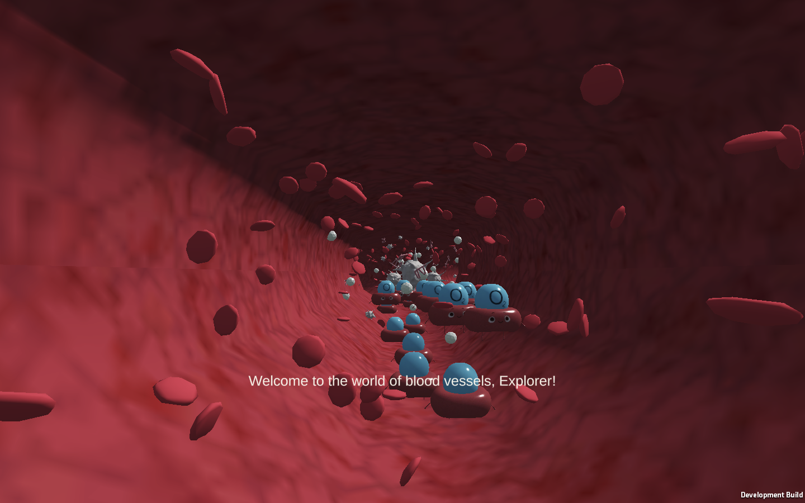 |

| Dialogue with a red blood cell | Third-person camera |
|---|---|
| 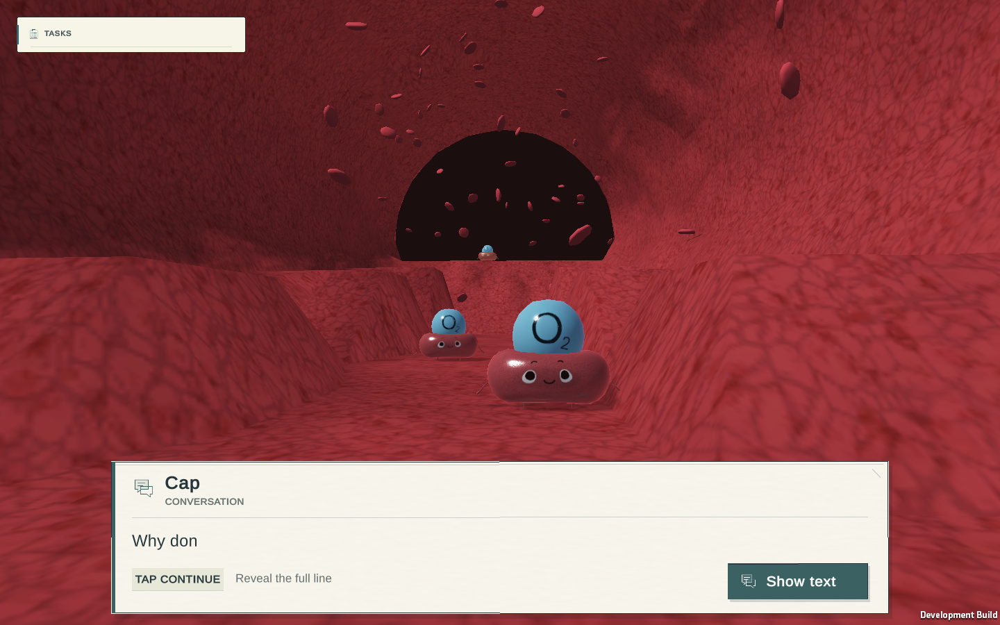 | 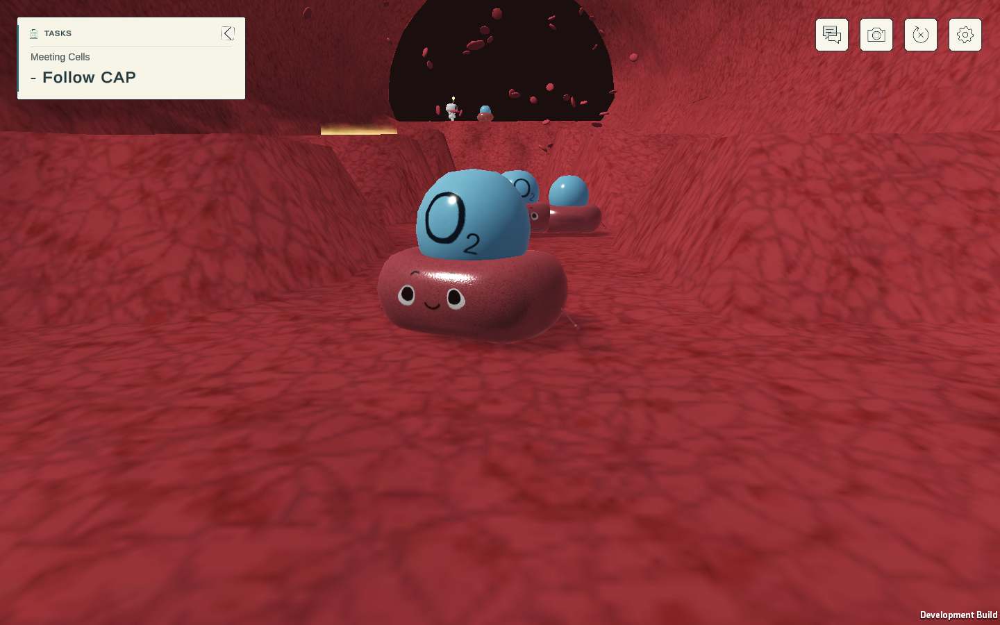 |

| First-person camera | Objective card HUD |
|---|---|
| 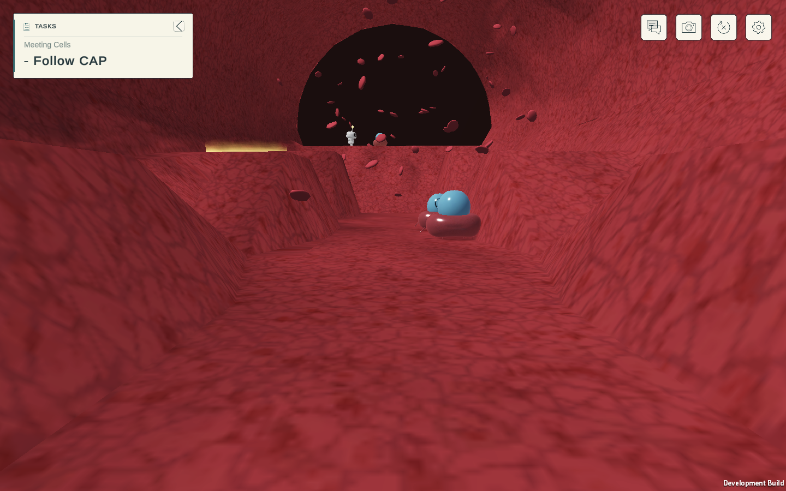 | 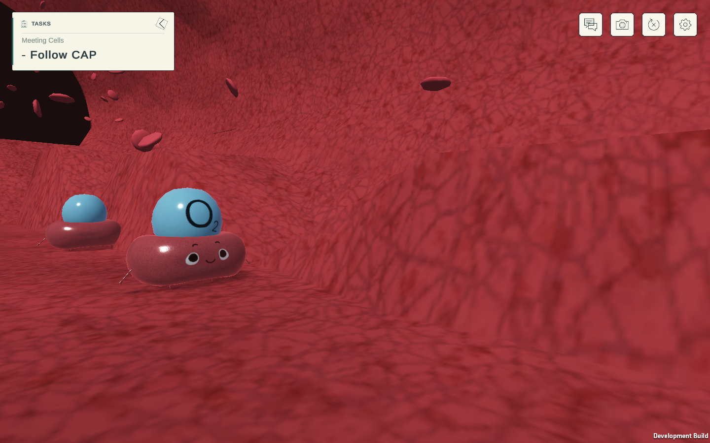 |

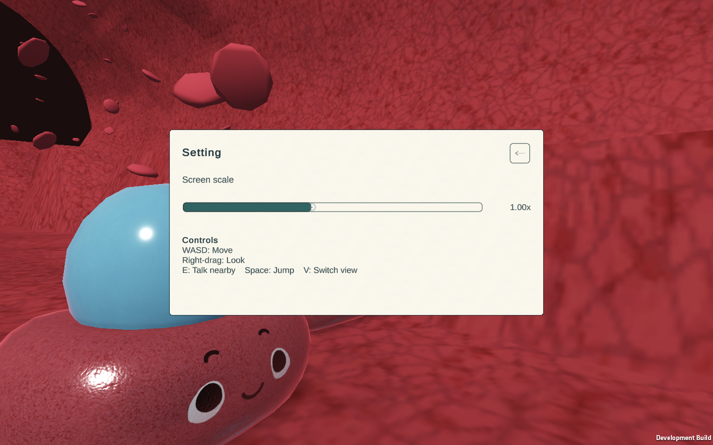

### Interaction (laptop, 1280×620)

Guides in reach get a white silhouette, a name label with a caret, and an ink line into brush-stroke choices (`E` Talk, `Q` Observe) tinted per character; guides in view but out of reach carry a quiet name tag and dot.

| Red | White |
|---|---|
| 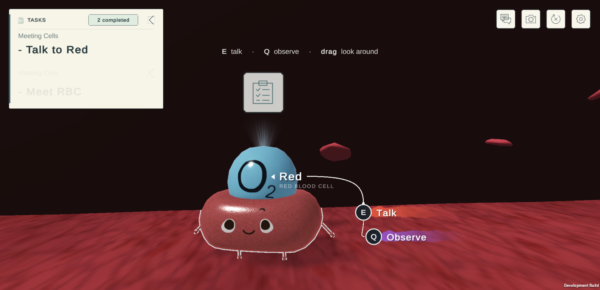 | 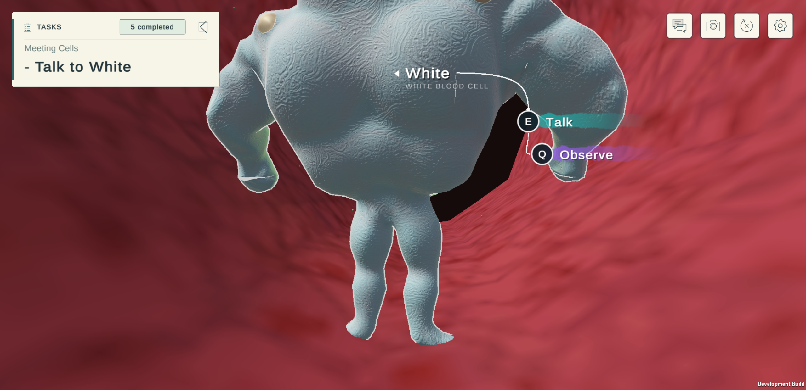 |

### Activities

| Oxygen Run | White-cell defence |
|---|---|
| 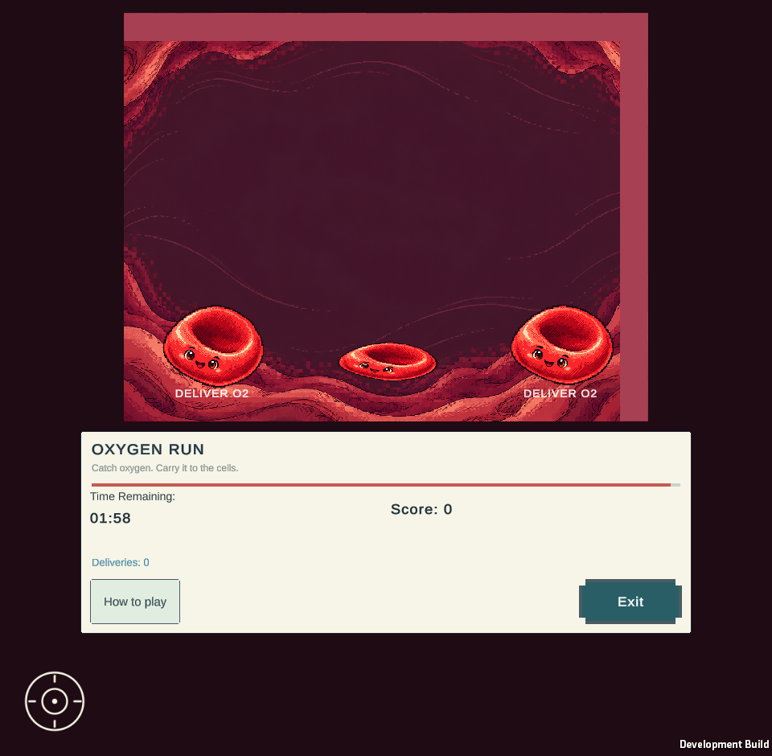 | 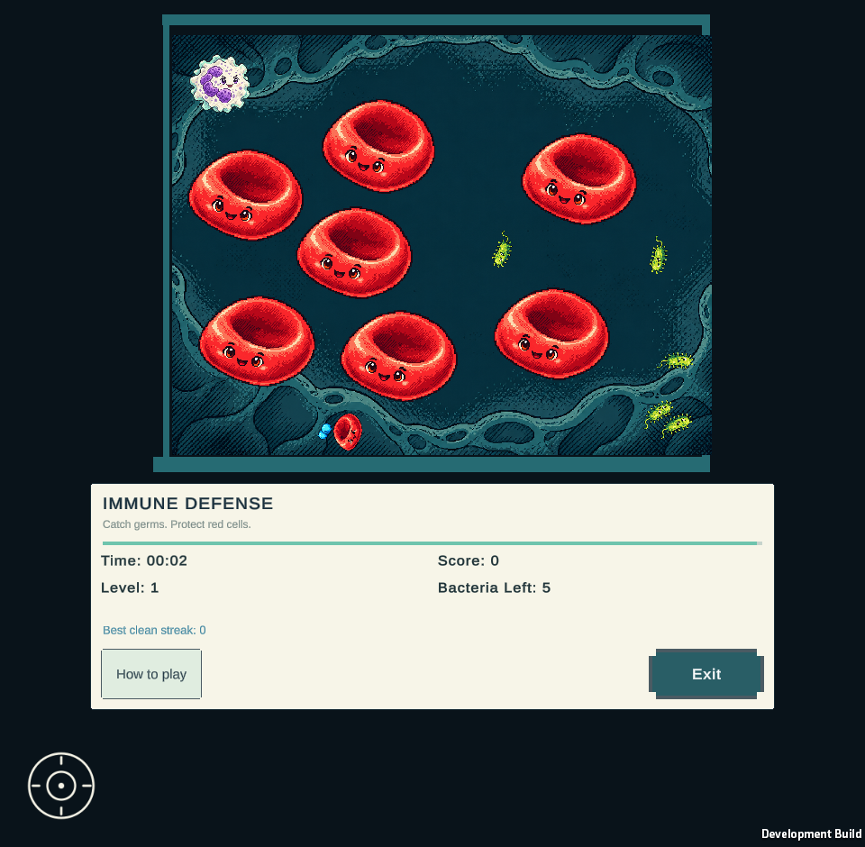 |

| Quiz | Peer explanation |
|---|---|
| 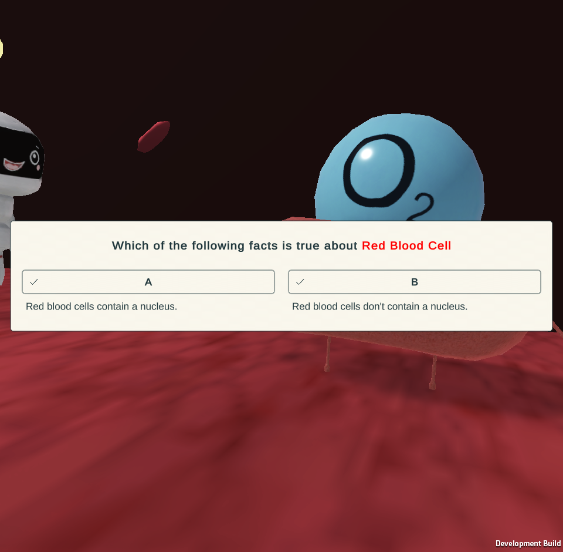 | 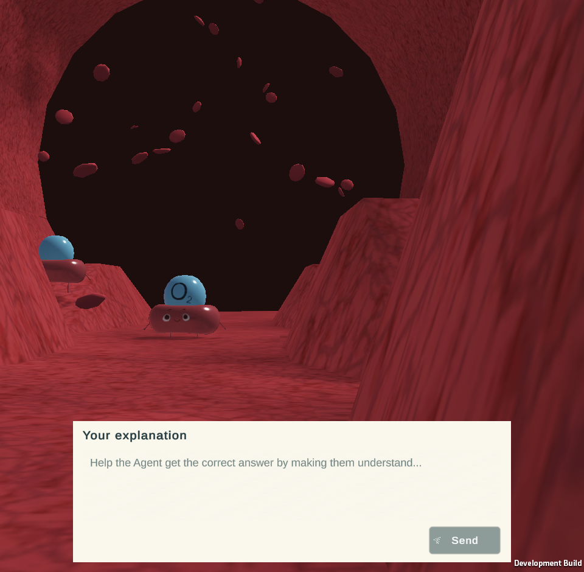 |

### Mobile

| Worksheet (390×844) | Portrait HUD | Ending card |
|---|---|---|
| 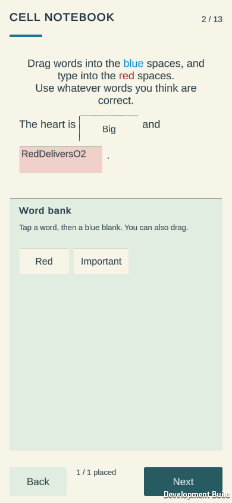 | 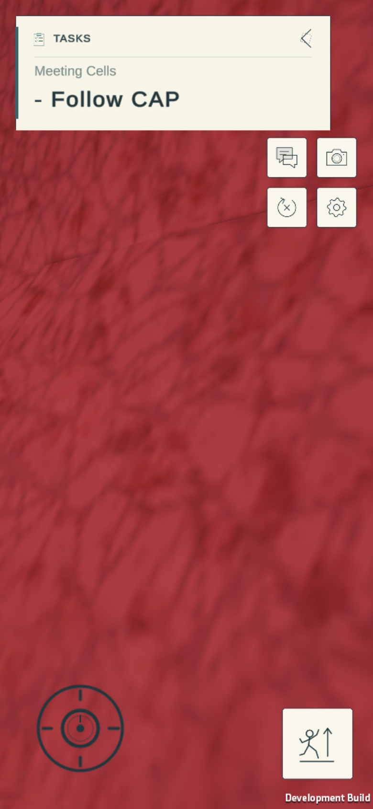 | 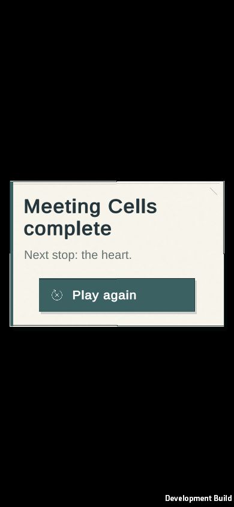 |

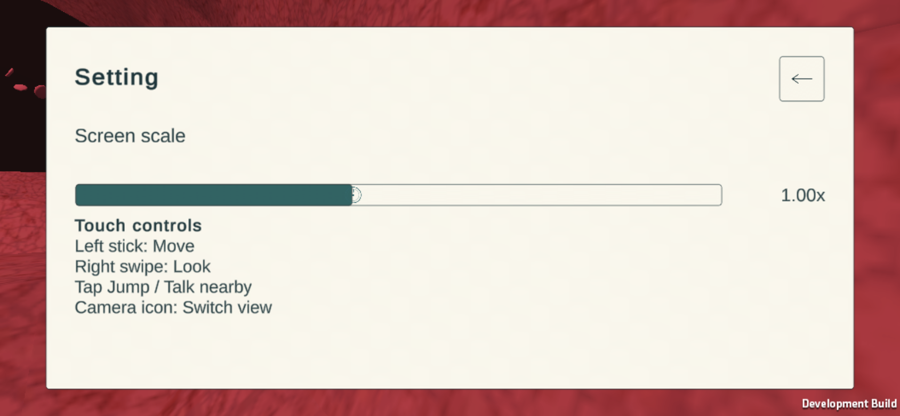

## Desktop and laptop fixes (2026-10-19)

- **Canvas scale.** Overlay canvases were rescaled with `1/parentScale`, which is only right when the CanvasScaler factor is 1 (the 1440×900 test profile). At other sizes, Unity's layout and the drawn pixels disagreed by the scale factor, pushing the minigame launcher off-screen on short laptop windows. `OriginalComponents.MatchOverlayScale` now matches the factor.
- **Launcher.** The Play RBC/WBC button lives in its own CSS-pixel overlay, bottom-centre, and the Talk prompt stacks above it.
- **Flicker.** The UI theme re-applied colours, sprites and margins to every graphic every 0.3 s, fighting the HUD, launcher, interaction and menu owners. It now styles each graphic once, and animated captions are fitted every frame. The objective button's spinning frame is held still.
- **Look.** Left-drag on the scene (trackpad friendly) and the arrow keys look around. Third-person pitch orbits the camera through its Follow target, because the Composer overwrote rotations applied to the virtual camera itself.
- **Camera clearance.** Characters that enter the lens, or stand between the third-person camera and the explorer, stop rendering until clear (with hysteresis).
- **Desktop cards.** IMGUI dialogue/start cards are sized in CSS pixels and fitted to the window, with crisp axis-aligned rules.
- **Standalone build.** The repo now carries the files Unity loads by path rather than by GUID: `BrowserPlatform.jslib`, the TMP shader includes and runtime resources, `MeetingCellsHighlight.shader`, `AppearanceCatalog.json`, the URP global settings, and folder metas.

Checks: `Tools/browser/original-journey.cjs` passes the full route at `SPARC_VIEWPORT=1280x620 SPARC_DPR=2` (with `SPARC_STUB_AGENT=1` when no provider credentials are configured). `Tools/browser/desktop-look-check.cjs` covers drag, arrow and pitch look. `Tools/browser/flicker-probe.cjs` measures zero changed pixels in idle UI cards.

Static hosting without `Content-Encoding` support: `python3 Tools/stage_static_release.py OUT_DIR` decompresses the release bundle and repoints `index.html`.

## Play locally

```sh
git clone git@github.com:CatfishW/SPARC_MeetingCells.git && cd SPARC_MeetingCells
python3 Tools/serve_webgl.py --port 8092
# Open http://127.0.0.1:8092/
```

The default serves `Builds/WebGLOriginalRelease/` over HTTP with WebAssembly/gzip headers and video byte-range support. The compiled distribution is `Deliverables/OriginalScene/SPARC_MeetingCells_Original_WebGL.zip`; extract it and run `python3 serve-preview.py --port 8092`. `--development` explicitly selects the development bundle with a read-only acceptance observer. The release has no test telemetry.

Desktop: WASD moves; drag on the scene (left or right button, trackpad friendly) or the arrow keys look around in both first and third person; Space jumps or advances dialogue; E interacts nearby; V switches the original first/third-person cameras; Tab requests/releases browser pointer capture.

Mobile: use the left thumbstick to move, swipe the right pad to look and tap Jump. Each pad owns its own finger. Dialogue and nearby interaction have touch actions. Native activity buttons and the original minigame joystick remain in use. Worksheet words support both drag/drop and tap-word, tap-blank; type into the original answer fields and use the original Next/Submit controls.

## Improvements

The main interface uses warm paper, ink outlines, readable type, teal accents and a 61-definition semantic icon library. Start, dialogue, subtitles, interaction prompts, objective cards, navigation, Settings, tooltips, inactive prefabs and dynamically created controls are covered. The objective card emphasizes the current instruction, folds through its native control and places the actual completion count in a compact header badge with a brief decorative task-change pulse. The toolbar fits before Start, and long intro captions wrap safely on phones while keeping their source text and timing. Utility targets are at least 44 CSS pixels. Settings hides the objective while open and returns through its native Back button.

Cinematic teaching cues use readable 20 CSS-pixel body text, 28-pixel titles, light lettering and dark outlines. Full source text wraps within the safe viewport while the original Content animation, typewriter progress and alpha remain in control. The thinking indicator and world-space teleport label also use light scene-overlay styling.

**Seven approved pixel-and-sketch assets replace the timed-game subjects/backgrounds and notebook cover.** Oxygen and White keep their native physics, source rules, colliders and scoring. Visual-only breathing/tilt, pickup/delivery bursts, clean-streak cues and new-wave feedback add motion without moving hitboxes. The two Oxygen targets are208 units wide with a432-unit edge gap, up from224; their collider centers match the visible targets. Native Help reveals scrollable original instructions while compact play leaves more room for the board. Their mobile arena and outer walls fit uniformly, with a bottom-left native joystick and bounded Exit/status controls. Score changes flash briefly and the last 15 seconds warn visibly. White retains its source loading-tip order and loss germ visual. Victory waits for native Continue; loss keeps its five-second continuation.

Activity layouts fit the viewport on wide, square and tall desktop windows as well as phones. The native board and borders scale uniformly; instructions use their original illustrations as small aligned row icons, with an explicit scroll hint when needed. Desktop instructions name keyboard controls. Launch buttons use a compact lower-screen position and wait until dialogue finishes.

Peer explanation screens use bounded forms with a visible Send action. Feedback actions are labeled Try again or Continue, long feedback scrolls, and world movement/avatar rendering are suspended while quiz or peer forms own input. The original 2,000-character input contract and source feedback callbacks remain in use.

The worksheet keeps all 13 source pages and 14 slots, diagrams, text, matching data and submission callbacks. Mobile reflow presents readable original sentence fragments, answer fields and word-bank tiles with at least 44 CSS-pixel targets. Placed words fill the visible blank, and rotation preserves assigned answers while cancelling stale drags and movement animations. The original Tutorial field retains its 16-character alphanumeric rule. The same notebook design adapts to desktop, square and phone viewports. Cancelled touch events also clear UI-module drags queued after browser lifecycle cancellation. Tile return positions use top-left anchors so the first bank size/pivot change cannot shift words on cancellation.

Mobile movement uses a dead zone, smooth analog response and visible thumb handle. In 3D exploration, movement targets are at least 128 CSS pixels; Jump is 76. Camera sensitivity follows viewport size. Focus loss, browser cancellation, rotation and modal transitions release held input. Layout responds to safe areas, DPR and late CanvasScaler updates. Touch rendering caps DPR at 1.25 to reduce GPU work; Settings retains its render-scale control.

The native third-person camera excludes the player's own capsule from obstacle checks while retaining environment collision. During camera blends or tight spaces, only the avatar's render layer is hidden when the actual output camera is too close to the body; the rig and its animation keep running. The native lens, follow distance, damping and cinematic assets remain unchanged.

Unity's native mobile edit bar uses the same paper/ink/teal palette, 16-pixel text and a 76×52 CSS-pixel OK target. Its exact engine-owned input/button objects, limits and handlers remain in use; multiline fields keep their native height. The browser host identifies this widget by its actual native object references before applying scoped styles. Nonzero phone notch insets and physical soft-keyboard behavior still require device acceptance.

The continuously spawning RBC blockers use the enabled source spawner: five authored spawn points, one-second interval, five-actor cap and the original scene-instance RBC template. Native navigation, solid collision, randomized lifetime, replenishment and source push/effect/sound references are restored. The separately disabled source spawner stays disabled. Existing source walkers and RBC bursts use their authored motion/lifetime parameters. NPC interaction requires actual proximity. The previous native interaction system now shows a pulsing character outline, its original curved connector, and a nearby Talk/Observe card. The original option buttons, controller references and source callbacks remain in use; dialogue/modal/game transitions suppress the popup and restore exact original character materials on leave.

Lighting has neutral ambient fill, softer shadows, muted vessel fog and a restrained private color grade. Original environment geometry/materials and camera tracks remain intact. The actual original rig receives locomotion parameters; verification observes the original run clip and moving bones. CAP's four destinations, White's clips, Red's limbs, expression materials and native Timeline signals remain in use.

## Story and asset fidelity

The fidelity audit covers **4,746 native serialized records, 29 story blocks, 416 commands, 107 Say/voice records, 23 Timeline assets, 19 standalone clips, 10 animator controllers and 20 scene directors**. Oxygen retains its **120-second** timer. White retains the source **250-second** limit, three levels and five hostile bacteria per level. Original media, animated cutouts, opacity and shader contracts are preserved.

Exact current test/build fingerprints, browser outcomes, source-backed screenshots and limitations belong in [CURRENT_STATUS.md](Reports/OriginalScene/CURRENT_STATUS.md). [DESIGN_SCOPE.md](Reports/OriginalScene/UiRedesign/DESIGN_SCOPE.md) records the UI preservation boundaries. `delivery-audit.json` only passes when test evidence, builds and browser artifacts match the current source. Earlier reports, failed exploratory attempts and recordings remain historical. Before-copies are under `Revisions/2026-10-17-resume/`.

The October18 follow-up adds a [self-contained visual UI gallery](Deliverables/OriginalScene/SPARC_MeetingCells_Original_UI_Audit.html) with 263 current captures, filtered by screen family and expandable to full size. Exact source-bound reviews are recorded in its manifest. Native previews and actual input-driven results are labeled separately. Current follow-up backups are under `Revisions/2026-10-18-ui-audit/` and `Revisions/2026-10-18-interaction-minigames/`.

## Reproduce verification

```sh
.tools-venv/bin/python Tools/verify_original_contracts.py
.tools-venv/bin/python Tools/verify_original_current.py
# Serve the development bundle in another terminal:
python3 Tools/serve_webgl.py --development --port 18093
# Original timers, real inputs, mobile worksheet/native-stick checks, full ending:
SPARC_TEST_ORIGIN=http://127.0.0.1:18093/ SPARC_MOBILE_WORKSHEET=1 SPARC_VERIFY_ENDING=1 SPARC_VISUAL_UI_AUDIT=1 SPARC_JOURNEY_SECONDS=1600 node Tools/browser/original-journey.cjs
SPARC_TEST_ORIGIN=http://127.0.0.1:18093/ node Tools/browser/original-mobile-controls.cjs
```

The full route uses mouse/keyboard for 3D navigation and genuine touch for native activity sticks and the worksheet. The separate mobile controls run uses genuine multi-touch browser input. Neither exposes gameplay setters, teleportation, score mutation, accelerated timers or Timeline seeking. Browser emulation cannot certify physical-phone frame pacing, heat, battery life or Safari. Silent browser videos do not establish audio acceptance.

`OriginalProjectBuilder.Prepare` regenerates the playable scene from its imported baseline; preserve manual scene edits before using it. `Tools/restore_original_assets.py` backs up differing destination assets and excludes old first-party C#.

## Integration boundaries

When the original Heart-transition Timeline starts, the standalone module locks world interaction. After its full ending finishes, a paper completion card appears. **Play again** reloads only this included scene into a fresh start. An interrupted ending does not count as completion. The transition's original camera/fade tracks and 20.3167-second duration remain intact.

The external Heart game remains a handoff. Signed-in PING outfit synchronization requires its real same-origin service and account. The retained multiplayer chat launcher has no accepted local panel/service in this isolated module. The peer provider follows the original unavailable-service fallback when unconfigured; no guessed local grading is substituted. Server credentials are supplied through environment variables and are excluded from Unity/distribution.

Physical phones, Safari, physical gamepads, every optional story branch and audio remain separate acceptance work.  Original artwork retains its existing ownership and license conditions.

Generated art provenance and full prompts are in `Reports/OriginalScene/GeneratedArt/assets.json` and `prompt-set.json`; selected PNGs are in `Assets/Resources/MeetingCellsArt/`. Generation used the built-in imagegen tool. Earlier glossy drafts were discarded after the pixel/sketch request.
